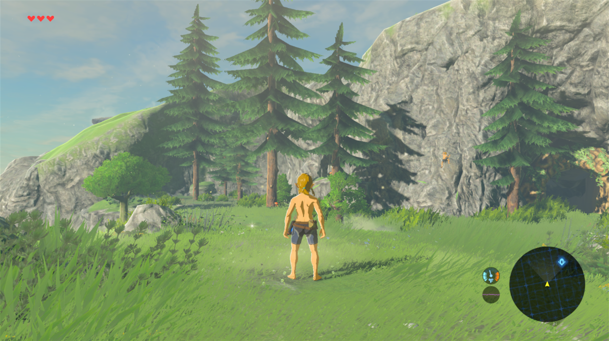
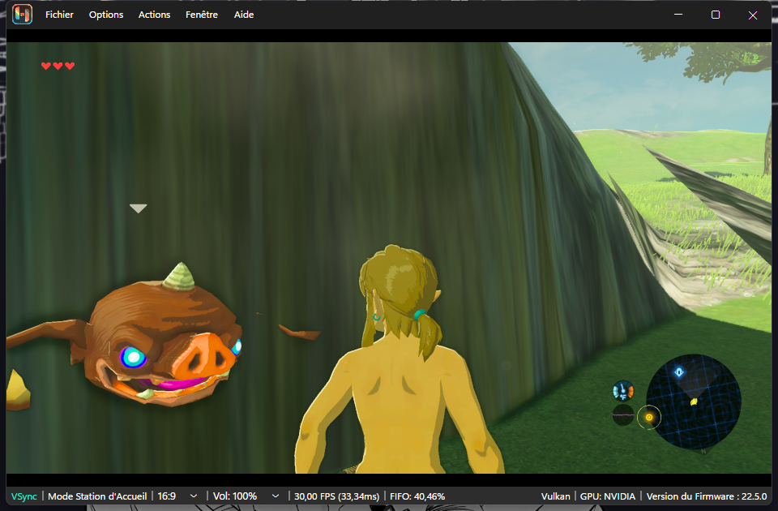

# BOTW Coop

Mod coopératif à deux joueurs pour *The Legend of Zelda: Breath of the Wild* 1.9.0 (Switch), sur émulateur (Eden ou Ryujinx). Les deux joueurs partagent le même monde : chacun voit l'autre, les ennemis, la progression, l'heure et la météo sont communs, et les récompenses sont données aux deux. Le mod est un plugin (`subsdk9`) qui ne modifie pas le jeu. **Aucun fichier du jeu n'est dans ce dépôt** : tout ce dont le mod a besoin est fabriqué sur votre PC à partir de votre propre copie.


*Le joueur 2 (au centre) voit le joueur 1 (à gauche) dans son monde.*

**Sommaire** : [Installation](#installation-simple--le-launcher) · [Fonctionnalités](#ce-que-fait-la-version-actuelle) · [État et limites](#état-vérifié-et-limites) · [Captures](#captures) · [Développeurs](#jouer-à-deux-à-la-main)

**Téléchargement** : onglet [Releases](https://github.com/dorianskyfr/BOTW-COOP-mod/releases/latest) (`BotwCoopLauncher.exe`).

## Captures

Images prises pendant les essais à deux instances (toutes les preuves : [`docs/evidence/`](docs/evidence/)).

| | |
|---|---|
|  |  |
| L'autre joueur est un Link animé : il grimpe, nage, plane comme le vrai | Son armure et ses armes |
|  |  |
| Alerte quand le partenaire n'a presque plus de cœurs | Messages dans le bandeau du jeu |
|  |  |
| Un objet ramassé par l'un disparaît chez l'autre | Les teintures de l'armure sont transmises |
|  |  |
| Un Bokoblin attaque : vu par le joueur 1… | … et par le joueur 2, même place, même animation |

Journal d'avancement : [`PROGRESS.md`](PROGRESS.md). Détails techniques : [`NOTES.md`](NOTES.md), [`ARCHITECTURE.md`](ARCHITECTURE.md). Décisions : [`DECISIONS.md`](DECISIONS.md).

## Ce que fait la version actuelle
- Chaque joueur voit l'autre dans son monde sous la forme d'un Link animé (attente, marche, course, sprint, escalade, nage, vol plané, chute, surf, saut, coups d'épée, tir à l'arc, parade), avec son armure (tête, torse, jambes, teintures comprises) et ses armes, bouclier, arc et carquois.
- Heure de la session (elle ne recule jamais ; un joueur en pause ne retient pas l'autre), jours, minuteur de lune de sang, météo (quand les deux joueurs sont dans le même climat).
- Drapeaux de la liste blanche : progression (sanctuaires, tours, Créatures divines, Koroks) et objets de carte (ramassés, ennemis tués). Les coffres, les étapes de quête, l'inventaire et le Compendium restent à chacun.
- **Inclinaison des Créatures divines** : quand un joueur fait pencher Vah Medoh, lève la trompe de Vah Ruta, fait tourner Vah Rudania ou un tambour de Vah Naboris avec sa tablette, la Créature bouge pareil chez l'autre, qui peut ensuite la commander à son tour. Dans Vah Rudania, si l'autre joueur tombe pendant la rotation, il est replacé au point sûr comme celui qui a commandé. Vérifié dans Vah Medoh dans les deux sens, dans Vah Ruta, dans Vah Rudania et dans Vah Naboris (journaux et captures pour Medoh et Ruta, journaux seuls pour Rudania et Naboris). `beast_rotate=0` coupe ce partage.
- **Récompenses pour les deux** : quand l'autre joueur termine un sanctuaire, vous recevez aussi un emblème du triomphe (chacun choisit ensuite cœur ou endurance à la statue) ; quand il libère une Créature divine, vous recevez aussi la compétence du Prodige. Dans les deux sens. Vérifié par un essai (2 sanctuaires et Vah Ruta annoncés : emblème ×2 et Grâce de Mipha dans les objets clés). Koroks : quand l'autre en trouve un, vous recevez aussi sa graine (vérifié : « Korok Seed » dans les objets clés). Réceptacles de cœur posés dans le monde et dans les Créatures divines : un chacun (celui ramassé par l'autre reste chez vous). `rewards=0` coupe les récompenses.
- Ennemis : points de vie, position et animations (le joueur le plus proche de l'ennemi fait foi, l'autre voit la même chose ; vérifié sur des Bokoblin, combat à l'épée compris : coups, fuite et mort vus par les deux joueurs). `enemy_pos=0` et `enemy_anim=0` dans `romfs\botw-coop.txt` coupent ces partages.
- **Cinématiques partagées** : quand une vraie cinématique démarre chez un joueur (liste tirée de votre jeu à l'installation : 63 cinématiques), elle démarre aussi chez l'autre s'il est à moins de 50 m ; plus loin, il rejoint le joueur (téléportation, ou voyage du jeu au-delà de 250 m) puis la voit ; s'il ne peut pas s'approcher, il voit « Joueur N regarde une cinématique ». Les événements du jeu (Game Over, coffre, chargement, aides) ne sont jamais partagés. Vérifié avec la cinématique de la lune de sang, pas encore avec une cinématique de l'histoire. `cutscene=0` coupe, `cutscene_range=<mètres>` change la distance, `cutscene_tp=0` coupe le déplacement.
- **Coffres : un chacun.** Chaque joueur ouvre son propre coffre et en reçoit le contenu ; un coffre ouvert par l'autre reste fermé chez soi. Avec `share_groups=1,2,4,6,8`, on revient au coffre commun : ouvert par l'un, il apparaît ouvert chez l'autre et disparaît à moins de 3 m.
- **Camps d'ennemis** : quand un joueur nettoie un camp, les ennemis disparaissent chez l'autre et son coffre du camp s'ouvre aussi ; chacun prend le sien. Vérifié à l'image sur deux camps (Bokoblins et Lézalfos).
- **Journaux** : en cas de souci, bouton « Journaux à envoyer » du launcher : une archive est créée sur le Bureau (journaux du jeu et du serveur, sans le mot de passe).
- Messages dans le bandeau du jeu quand l'autre joueur arrive ou part, et à la connexion.
- **Téléportation vers l'autre joueur** : maintenir le clic du stick gauche 1,5 s. Jusqu'à 250 m, Link arrive à côté de lui ; plus loin, le jeu fait un voyage (chargement) vers le sanctuaire ou la tour le plus proche de lui, puis Link le rejoint. Un clic court accroupit Link comme d'habitude.
- **Sauvegardes coop séparées** : au premier lancement avec le mod, vos sauvegardes sont copiées dans un dossier `coop` des données de sauvegarde du jeu (les originales sont seulement lues) ; ensuite le jeu ne lit et n'écrit que cette copie. Retirer le mod rend vos sauvegardes normales, inchangées.
- **Sauvetage par le partenaire** : à votre mort, si aucune fée ni la Grâce de Mipha ne vous sauve et que l'autre joueur est en jeu, vivant et à moins de 150 m, vous repartez avec 3 cœurs (au plus une fois toutes les 2 minutes) ; votre partenaire en est averti. Réglages dans `romfs\botw-coop.txt` : `revive=0` pour couper, `revive_delay=<secondes>`, `revive_range=<mètres>`.
- **Objets lâchés partagés** : une arme ou un bouclier lâché (menu « Lâcher »), ou un matériau posé (menu, « Tenir », fermer le menu, puis A), reste par terre et apparaît au même endroit chez l'autre joueur s'il est à moins de 120 m, avec la même usure. Le premier qui le ramasse le garde : la copie de l'autre disparaît (aussi si l'objet est détruit, une arme en bois qui brûle par exemple). Le bonus d'une arme (« Attaque + »…) suit la copie, y compris après une sauvegarde. Ramassé par les deux au même instant : celui qui l'a lâché le garde, l'autre le perd. Si vous rechargez une partie après avoir lâché un objet, vous le retrouvez dans votre inventaire et la copie de l'autre joueur reste au sol.
- **Épée de légende** : chacun la retire du socle dans son propre monde (elle ne disparaît plus chez l'autre).
- **Bombes de la tablette** : la bombe ronde ou cube d'un joueur (tenue, posée, lancée, qui roule) apparaît au même endroit chez l'autre (vu à l'image) et explose chez lui au même moment, avec la sphère bleue de l'explosion (vue à 13 m, NOTES 6.22) et son souffle (le joueur proche est projeté). Attention : chez l'autre, l'explosion peut aussi le blesser s'il est trop près.
- **Serveur arbitre** : pour chaque ennemi, le serveur décide quel joueur fait foi (le plus proche, avec 2 m de marge) et l'annonce aux deux jeux, qui suivent la même décision.
- **Repas partagés** : ce que vous mangez depuis le menu soigne aussi l'autre joueur, du même nombre de cœurs (`meal=0` pour couper). Les effets des plats ne sont pas partagés.
- **L'autre joueur sur la carte** : un tampon du jeu marque sa position et le suit ; il disparaît quand il quitte la partie (`map=0` pour couper). Vu sur l'écran de la carte.
- **Contrôle de version** : le relais refuse un jeu dont le mod n'a pas la même version que lui (et inversement) ; un message l'indique dans le jeu, qui réessaie toutes les minutes. Mettre à jour le mod et le relais ensemble.
- Inventaire, santé et équipement restent individuels.

## État vérifié et limites

Vérifié avec deux instances de Ryujinx 1.3.3, et avec deux instances d'Eden v0.2.1, **sur un même PC** (journaux et captures : `docs/evidence/`, détail dans `PROGRESS.md` et `NOTES.md`).

- **Ennemis** : Bokoblin, Moblin (vie, attaques, dégâts), Lézalfos (animations), Lynel (vie, position, animations, y compris celles de son second créneau : cri, dégainer, charge), Hinox (vie, réveil, animations), Gardiens volants (vie et position, vus au même endroit dans les deux jeux), Gardiens fixes et Tourelles du château (suivis ; leurs mouvements dépendent de chaque jeu), Gardiens : leur rayon ne touche que le joueur le plus proche (vu à l'image). Le monstre vise le joueur le plus proche de lui. Un ennemi vaincu chez l'un est retiré chez l'autre, y compris quand le jeu l'a fait monter de rang (mode expert, progression de la partie) : le mod lit le drapeau exact de son objet de carte.
- **Mode expert** : vérifié (parties chargées depuis une sauvegarde en mode expert).
- **Lune de sang** : déclenchée par le jeu chez les deux joueurs au même minuit.
- **Créatures divines** : les deux joueurs entrent ensemble ; énigmes, bornes, coffres et ennemis vaincus partagés (Vah Medoh). Pour les quatre Créatures, le Fléau apparaît et meurt chez les deux, et la libération passe chez l'autre, qui reçoit le pouvoir du Prodige (essais avec outil, NOTES 6.18, 6.19).
- **Sanctuaires** : les deux joueurs entrent ensemble, ennemis vaincus partagés ; les objets qu'on déplace (blocs, boules, bougies…) se déplacent chez les deux (le joueur le plus proche fait foi, NOTES 6.23) ; la fin du sanctuaire est partagée.
- **DLC** : Épreuve de l'épée et sanctuaires de la Ballade des Prodiges, les deux joueurs entrent ensemble, ennemis vaincus partagés.
- **Réseau** : relais protégé (mot de passe, connexions limitées, messages invalides ignorés, client trop lent déconnecté).

- **Boss** : les quatre Fléaux du château, Ganon puis Ganon bête du Fléau (combat final), combattus ensemble ; un boss battu chez l'un meurt chez l'autre et les deux jeux enchaînent la suite jusqu'à la fin (vu à l'image).

Pas encore vérifié : une partie **entre deux PC** et **par VPN** ; à l'image : un vrai combat contre les Fléaux dans les Créatures divines (abattus par un outil d'essai, NOTES 6.19), une épreuve de l'épée complète, la Ballade des Prodiges jouée. Les tirs du Gardien volant et des Tourelles sont vus dans les journaux, et retirés chez celui qui suit. Limites détaillées : `PROGRESS.md`, « Limites connues ».

**Limites connues, gardées volontairement** :
- **Deux joueurs** au plus.
- **Feu** : un feu allumé par une flèche de feu ou un bâton de feu démarre aussi chez l'autre, et son jeu le propage ; l'étendue brûlée peut différer un peu. Les autres feux (silex, torche, foudre, ennemis) restent propres à chacun.
- **Énigme de sanctuaire en cours** : seuls les objets qu'on déplace sont partagés. Le feu (lierre, torches), l'électricité, l'eau, un interrupteur enfoncé par le corps d'un joueur et les labyrinthes à inclinaison restent propres à chacun.
- **Le Link du partenaire a une collision** : on ne le traverse pas.
- **Chacun garde** son inventaire, sa santé, son équipement et l'épée de légende.
- **Bombes** : l'explosion de la bombe de l'autre est une vraie explosion dans votre monde ; son souffle peut vous projeter et vous blesser.
- **Pare-feu Windows** : au premier lancement du relais, Windows demande d'autoriser Python ; sans cela, un second PC ne peut pas le joindre.

## Installation simple : le launcher

`BotwCoopLauncher.exe` (onglet Releases du dépôt) installe, met à jour et lance le mod. Interface sombre : l'image du jeu affichée en haut est lue dans **votre** `.nsp` (icône du jeu), et les captures du carrousel viennent de ce dépôt ; aucune image du jeu n'est livrée dans l'exe.

1. **Paramètres** (ouverts d'office au premier lancement) : l'émulateur (`Ryujinx.exe` ou `eden.exe`), le jeu de base (`.nsp`) et la mise à jour 1.9.0 (`.nsp`). L'émulateur doit déjà avoir vos clés (`prod.keys`) et son firmware.
   **Eden** : le launcher installe la mise à jour 1.9.0 dans la NAND d'Eden (sans elle, Eden démarre le jeu 1.0.0 et le mod se coupe), et le mod dans `user\load` (Eden portable) ou `%APPDATA%\eden\load`. À deux sur ce PC, le joueur 2 a sa propre copie d'Eden (`%LOCALAPPDATA%\BotwCoop\joueur2-eden`, quelques Go la première fois) : Eden verrouille ses fichiers, deux fenêtres ne peuvent pas partager les mêmes.
2. Choisir « J'héberge » (votre adresse s'affiche, à donner à l'autre joueur), « Je rejoins un ami » (avec son adresse) ou **« À deux sur ce PC »**, et un mot de passe si vous voulez. À deux sur ce PC, « Jouer » ouvre deux fenêtres : le joueur 2 a son propre dossier Ryujinx (`%LOCALAPPDATA%\BotwCoop\joueur2`), préparé la première fois à partir du vôtre (clés, réglages, copie de vos sauvegardes si la case est cochée dans les Paramètres). Il faut une manette par joueur : la première fois, réglez celle du joueur 2 dans sa fenêtre (Options > Paramètres > Entrées).
   **Par internet** : installez tous les deux un VPN privé gratuit, **Tailscale** ou **ZeroTier**, et rejoignez le même réseau. L'hôte coche « Jouer par internet avec un VPN » dans les Paramètres : son serveur écoute alors aussi sur son adresse VPN (affichée sous « J'héberge »), que l'autre joueur saisit dans « Je rejoins un ami ». Seuls les appareils de votre VPN peuvent s'y connecter : rien n'est ouvert sur internet (pas de redirection de port). Détection : carte réseau Tailscale ou ZeroTier, ou adresse dans 100.64.0.0/10 (RFC 6598). Non essayé avec un vrai VPN (vérifié : le serveur écoute sur deux adresses à la fois).
   Invité : le bouton **Tester** vérifie que le serveur de l'hôte répond (l'hôte doit avoir cliqué sur « Jouer ») ; « Jouer » fait la même vérification et prévient en cas d'échec. Hôte : la première fois, Windows peut demander d'autoriser « Python » sur le réseau : cliquer sur « Autoriser » (réseaux privés), sinon l'autre PC ne pourra pas se connecter.
3. **Installer / Mettre à jour** : le launcher télécharge la dernière version du mod, lit dans votre jeu les fichiers dont il a besoin (lecture seule), fabrique le Link de l'autre joueur, la liste des drapeaux partagés, etc. (Python portable de python.org et paquets `oead`, `rstb` de PyPI, dans `%LOCALAPPDATA%\BotwCoop`), puis copie le tout dans le dossier des mods de l'émulateur. Avec Ryujinx, il active « Ignorer les services manquants » et sélectionne la mise à jour 1.9.0 dans Ryujinx (copies de sécurité `*.avant-botw-coop`). Environ une minute la première fois.
4. **Sauvegarde de la partie coop** : le relais de l'hôte garde la progression partagée (sanctuaires, tours, Koroks, objets pris, ennemis vaincus), l'heure et le jour de la session dans `%LOCALAPPDATA%\BotwCoop\parties\partie-coop.json`, et la redonne à chaque joueur qui entre en jeu. En entrant en jeu, chaque jeu lui renvoie aussi sa propre progression : si c'est l'autre joueur qui héberge la fois suivante, sa partie se reconstruit à partir des deux jeux. Rien n'est jamais retiré. Le pied de page du launcher en donne l'état.
5. **Jouer** : installe le mod s'il ne l'est pas encore, ou la dernière version si elle a changé (les deux joueurs doivent avoir la même, le relais refuse deux versions différentes), puis lance le relais (pour l'hôte, sur le réseau local, ou aussi sur le VPN si la case est cochée) et l'émulateur.

Au démarrage, le launcher se remplace lui-même s'il existe un launcher plus récent : il compare sa version à `launcher.json` de la dernière release, qui ne change que si le launcher a changé (sinon pas de nouveau téléchargement de 52 Mo). Aucun fichier du jeu n'est distribué : tout est fabriqué sur votre PC, à partir de votre copie. Préparer une release : `tools\make-release.ps1 -Version a.b.c` (trois fichiers dans `build\release` : `botw-coop-mod.zip`, `BotwCoopLauncher.exe`, `launcher.json`, à publier comme release `va.b.c` du dépôt public ; la version du launcher est gardée dans `tools\launcher\RELEASED`).

## Jouer à deux (à la main)

Il faut, sur chaque PC : BOTW avec la mise à jour 1.9.0, Ryujinx, et ce dépôt compilé (voir plus bas).

1. **Sur le PC hôte, lancer le relais** :
   ```
   python tools\relay.py --host <adresse LAN du PC hôte> --password <mot de passe>
   ```
   Sans `--host`, le relais n'écoute que sur 127.0.0.1 (deux instances sur le même PC). Windows demandera d'autoriser Python dans le pare-feu : c'est nécessaire pour qu'un autre PC se connecte. Ne pas rediriger de port vers Internet.
   `--password` est conseillé sur un réseau partagé : seuls les jeux qui ont le même mot de passe entrent dans la partie. Il ne passe jamais en clair sur le réseau (défi + SHA-256). Sans `--password`, tout jeu du réseau peut entrer.
2. **Générer les fichiers du mod tirés de votre jeu** (une fois, sur chaque PC ; voir « Liste blanche » plus bas) : liste blanche des drapeaux et Link de l'autre joueur. Sans eux, rien n'est partagé à part la présence, l'heure et les ennemis, et l'autre joueur est un villageois.
3. **Installer le mod dans Ryujinx**, sur chaque PC :
   ```
   powershell -ExecutionPolicy Bypass -File tools\install-mod.ps1 -DataDir "<dossier de données Ryujinx>" -Relay <adresse LAN du PC hôte>:47800 -Password <mot de passe>
   ```
   (`-Password` : le même que celui du relais ; 63 caractères au plus, sans espace ni accent.)
   Le dossier de données est celui qui contient `mods`, `bis`, `system` (installation standard : `%APPDATA%\Ryujinx`). Dans la configuration de Ryujinx, « Ignorer les services manquants » doit être activé (sinon le jeu 1.9.0 s'arrête après environ 2 minutes).
4. Lancer le jeu sur les deux PC et charger une partie. Le personnage de l'autre joueur apparaît une vingtaine de secondes après l'entrée en jeu, s'il est à moins de 120 m.

Désinstaller : `tools\install-mod.ps1 -DataDir "<dossier>" -Uninstall`.

Essai à deux fenêtres sur un seul PC, sans toucher à l'installation réelle de Ryujinx : `tools\play-duo.ps1` (dossiers de données de test dans `build\ryu\`).

## Compiler
Prérequis : MSYS2 avec devkitPro (devkitA64, libnx), exlaunch dans `third_party\exlaunch` (voir NOTES.md pour les versions et les sources).
```
bash plugin/build.sh "<chemin du projet>"
```
Résultat : `build\deploy\subsdk9`.

## Liste blanche des drapeaux

Le mod ne partage que les drapeaux d'une liste générée depuis **votre** copie du jeu (rien de Nintendo n'est dans ce dépôt). Tout reste dans `build\` :

1. SDK .NET portable (script officiel de Microsoft, sans rien installer dans le système) :
   ```
   powershell -ExecutionPolicy Bypass -File build\tools\dotnet-install.ps1 -Channel 10.0 -InstallDir build\tools\dotnet -NoPath
   ```
   (`dotnet-install.ps1` se télécharge depuis `https://dot.net/v1/dotnet-install.ps1`.)
2. Outil de lecture de la RomFS (`tools\romfs-extract`, bibliothèque `Ryujinx.LibHac`) :
   ```
   build\tools\dotnet\dotnet.exe build tools\romfs-extract\RomfsExtract.csproj -c Release -o build\tools\romfs-extract
   build\tools\romfs-extract\RomfsExtract.exe "%APPDATA%\Ryujinx\system\prod.keys" "<jeu de base .nsp>" "<mise à jour 1.9.0 .nsp>" build\romfs-1.9.0 /Pack/Bootup.pack
   ```
   Clés et NSP sont seulement lus. Pour le DLC (outil d'essai seulement) : `RomfsExtract.exe <prod.keys> --aoc "<DLC The Master Trials .nsp>" build\romfs-aoc /Map/AocField/` (ou `--list <filtre>`).
3. Catalogue des drapeaux puis liste blanche (Python avec le paquet `oead` de PyPI) :
   ```
   python -m venv build\venv
   build\venv\Scripts\python.exe -m pip install oead
   build\venv\Scripts\python.exe -I tools\gamedata_names.py build\romfs-1.9.0 build\gamedata\flags.tsv
   build\venv\Scripts\python.exe -I tools\build_sync_flags.py build\gamedata\flags.tsv build\deploy\romfs\botw-coop\sync-flags.bin
   build\venv\Scripts\python.exe -I tools\build_travel_points.py build\romfs-1.9.0 build\deploy\romfs\botw-coop\travel-points.txt
   ```
   La dernière ligne liste les sanctuaires et tours (voyage vers un partenaire à plus de 250 m).
4. Le Link qui représente l'autre joueur (acteur `CoopPlayer`) et ses pièces d'armure (acteurs `CoopGear_*`), à partir de quelques fichiers de plus :
   ```
   build\tools\romfs-extract\RomfsExtract.exe "%APPDATA%\Ryujinx\system\prod.keys" "<jeu de base .nsp>" "<mise à jour 1.9.0 .nsp>" build\romfs-1.9.0 /Actor/Pack/Npc_DungeonPriest001.sbactorpack /Actor/Pack/PauseMenuPlayer.sbactorpack /Actor/Pack/Armor_ /Actor/Pack/Weapon_ /Model/Armor_ /Actor/ActorInfo.product.sbyml /System/Resource/ResourceSizeTable.product.srsizetable
   build\venv\Scripts\python.exe -m pip install rstb
   build\venv\Scripts\python.exe -I tools\build_puppet.py build\romfs-1.9.0 build\deploy\romfs
   ```
   Sans ces fichiers, l'autre joueur apparaît sous la forme d'un villageois. Sans les `Armor_*` / `Weapon_*`, il apparaît sans armure / sans armes. Sans les modèles `Model/Armor_*`, ses pièces teintes gardent leur couleur d'origine.
5. Noms des objets dans les bandeaux de don (textes français du jeu) :
   ```
   build\tools\romfs-extract\RomfsExtract.exe "%APPDATA%\Ryujinx\system\prod.keys" "<jeu de base .nsp>" "<mise à jour 1.9.0 .nsp>" build\romfs-1.9.0 /Pack/Bootup_EUfr.pack
   build\venv\Scripts\python.exe -I tools\build_item_names.py build\romfs-1.9.0 EUfr build\deploy\romfs
   ```
   Sans ce fichier, le bandeau dit « une arme », « un bouclier », « un arc » ou « un objet ».

`install-mod.ps1` et `run-live.ps1` copient ensuite `build\deploy\romfs` dans le mod.

Groupes (réglage `share_groups=` dans `romfs\botw-coop.txt`, par défaut `1,2,6,8`) : 1 progression (430 drapeaux : sanctuaires, Créatures divines, tours), 2 objets de carte (29 909, y compris dans les sanctuaires et les Créatures divines), 3 camps d'ennemis nettoyés (485 portes logiques `LinkTag` : coffre du camp débloqué chez l'autre ; inactif par défaut, non vérifié), 4 coffres (1 608, inactif par défaut : un coffre chacun), 6 Koroks (900, graine donnée aux deux), 7 réceptacles de cœur (22, inactif par défaut : un chacun), 8 énigmes des Créatures divines (29 : portes, volets, fissures, raccourcis). Tant qu'un joueur n'a pas la paravoile, la progression reçue attend (les sanctuaires du plateau donnent les runes).

## Outils de test
`tools\run-live.ps1` et `tools\drive.py` lancent une ou deux instances (Ryujinx, ou Eden avec `-Emu eden`) et les pilotent par le réseau (déplacements, voyages, boutons, captures d'écran). Ils demandent une build de test (`-Defines '-DCOOP_REMOTE_PAD'`), à ne pas utiliser pour jouer ; une build de release n'en contient aucun. Autres options d'essai : `-DCOOP_TEST_GODMODE` (vie de Link maintenue), `-DCOOP_TEST_SETLOCAL=0x<hachage>` (le joueur 1 pose un drapeau), `-DCOOP_TEST_LOG_ALL_SEQ` (toutes les animations d'ennemis au journal). Options d'essai de l'armure : `-DCOOP_TEST_SPAWN -DCOOP_TEST_GEAR` (Link témoin à 3 m, en tenue hylienne), `-DCOOP_TEST_WEAR` (deux instances : J1 annonce la tenue 001, J2 la tenue 005), `-DCOOP_TEST_GIVE` (ajoute pommes, armure hylienne, épée, bouclier et arc à l'inventaire de la copie de test, à équiper par le menu ; avec `-DCOOP_TEST_BONUS`, l'épée a le bonus « Attaque + » 10). `drive.py <nom> lift` soulève Link de 50 m (essai du sauvetage). Réseau dégradé : `relay.py --lag 150 --jitter 50` retarde chaque message de 150 à 200 ms (`run-live.ps1 -RelayArgs '--lag 150 --jitter 50'`) ; `--pretend-version 99` fait passer le relais pour une autre version.
