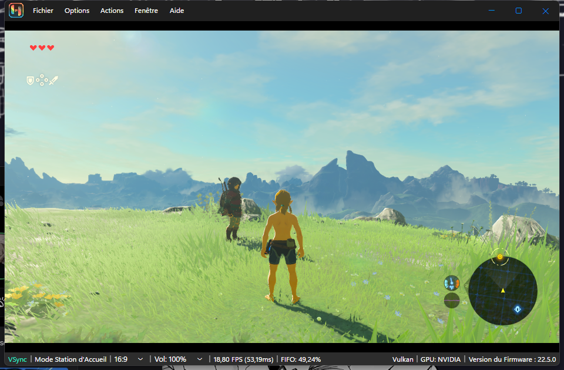

# BOTW coop (prototype)

Mod de présence à deux joueurs pour *The Legend of Zelda: Breath of the Wild* 1.9.0 (Switch), chargé comme plugin (`subsdk9`), sans modifier le jeu. Aucun fichier du jeu n'est dans ce dépôt.


*Le joueur 2 (au centre) voit le joueur 1 (à gauche) dans son monde.*

## Captures

Images prises pendant les essais à deux instances (toutes les preuves : `docs/evidence/`).

| | |
|---|---|
|  |  |
| L'autre joueur est un Link animé : il grimpe, nage, plane comme le vrai | Son armure et ses armes (couleurs de l'armure pas encore justes) |
|  |  |
| Alerte quand le partenaire n'a presque plus de cœurs | Messages dans le bandeau du jeu |
|  | |
| Un objet ramassé par l'un disparaît chez l'autre | |

État réel, limites et preuves : `PROGRESS.md`. Détails techniques : `NOTES.md`, `ARCHITECTURE.md`. Décisions : `DECISIONS.md`.

## Ce que fait la version actuelle
- Chaque joueur voit l'autre dans son monde sous la forme d'un Link animé (attente, marche, course, sprint, escalade, nage, vol plané, chute), avec son armure (tête, torse, jambes ; couleurs pas encore justes : les pièces gardent leur teinte par défaut) et ses armes, bouclier, arc et carquois.
- Heure de la session (elle ne recule jamais ; un joueur en pause ne retient pas l'autre), jours, minuteur de lune de sang, météo (à moins de 300 m).
- Drapeaux de la liste blanche : progression (sanctuaires, tours, Créatures divines, Koroks) et objets de carte (ramassés, coffres, ennemis tués). Les étapes de quête, l'inventaire et le Compendium restent à chacun.
- Points de vie et position des ennemis (première version).
- Messages dans le bandeau du jeu quand l'autre joueur arrive ou part, et à la connexion.
- **Téléportation vers l'autre joueur** : maintenir le clic du stick gauche 1,5 s (jusqu'à 250 m). Un clic court accroupit Link comme d'habitude.
- **Sauvegardes coop séparées** : au premier lancement avec le mod, vos sauvegardes sont copiées dans un dossier `coop` des données de sauvegarde du jeu (les originales sont seulement lues) ; ensuite le jeu ne lit et n'écrit que cette copie. Retirer le mod rend vos sauvegardes normales, inchangées.
- **Sauvetage par le partenaire** : à votre mort, si aucune fée ni la Grâce de Mipha ne vous sauve et que l'autre joueur est en jeu, vivant et à moins de 150 m, vous repartez avec 3 cœurs (au plus une fois toutes les 2 minutes). Réglages dans `romfs\botw-coop.txt` : `revive=0` pour couper, `revive_delay=<secondes>`, `revive_range=<mètres>`.
- Inventaire, santé et équipement restent individuels.

Testé uniquement avec deux instances de Ryujinx 1.3.3 sur un même PC. Non testé entre deux PC, ni sous Eden.

## Jouer à deux

Il faut, sur chaque PC : BOTW avec la mise à jour 1.9.0, Ryujinx, et ce dépôt compilé (voir plus bas).

1. **Sur le PC hôte, lancer le relais** :
   ```
   python tools\relay.py --host <adresse LAN du PC hôte>
   ```
   Sans `--host`, le relais n'écoute que sur 127.0.0.1 (deux instances sur le même PC). Windows demandera d'autoriser Python dans le pare-feu : c'est nécessaire pour qu'un autre PC se connecte. Ne pas rediriger de port vers Internet.
2. **Générer les fichiers du mod tirés de votre jeu** (une fois, sur chaque PC ; voir « Liste blanche » plus bas) : liste blanche des drapeaux et Link de l'autre joueur. Sans eux, rien n'est partagé à part la présence, l'heure et les ennemis, et l'autre joueur est un villageois.
3. **Installer le mod dans Ryujinx**, sur chaque PC :
   ```
   powershell -ExecutionPolicy Bypass -File tools\install-mod.ps1 -DataDir "<dossier de données Ryujinx>" -Relay <adresse LAN du PC hôte>:47800
   ```
   Le dossier de données est celui qui contient `mods`, `bis`, `system` (installation standard : `%APPDATA%\Ryujinx`). Dans la configuration de Ryujinx, « Ignorer les services manquants » doit être activé (sinon le jeu 1.9.0 s'arrête après environ 2 minutes).
4. Lancer le jeu sur les deux PC et charger une partie. Le personnage de l'autre joueur apparaît une vingtaine de secondes après l'entrée en jeu, s'il est à moins de 120 m.

Désinstaller : `tools\install-mod.ps1 -DataDir "<dossier>" -Uninstall`.

Essai à deux fenêtres sur un seul PC, sans toucher à l'installation réelle de Ryujinx : `tools\play-duo.ps1` (dossiers de données de test dans `build\ryu\`).

## Compiler
Prérequis : MSYS2 avec devkitPro (devkitA64, libnx), exlaunch dans `third_party\exlaunch` (voir NOTES.md pour les versions et les sources).
```
bash plugin/build.sh "<chemin du projet>"
```
Résultat : `build\deploy\subsdk9`.

## Liste blanche des drapeaux

Le mod ne partage que les drapeaux d'une liste générée depuis **votre** copie du jeu (rien de Nintendo n'est dans ce dépôt). Tout reste dans `build\` :

1. SDK .NET portable (script officiel de Microsoft, sans rien installer dans le système) :
   ```
   powershell -ExecutionPolicy Bypass -File build\tools\dotnet-install.ps1 -Channel 10.0 -InstallDir build\tools\dotnet -NoPath
   ```
   (`dotnet-install.ps1` se télécharge depuis `https://dot.net/v1/dotnet-install.ps1`.)
2. Outil de lecture de la RomFS (`tools\romfs-extract`, bibliothèque `Ryujinx.LibHac`) :
   ```
   build\tools\dotnet\dotnet.exe build tools\romfs-extract\RomfsExtract.csproj -c Release -o build\tools\romfs-extract
   build\tools\romfs-extract\RomfsExtract.exe "%APPDATA%\Ryujinx\system\prod.keys" "<jeu de base .nsp>" "<mise à jour 1.9.0 .nsp>" build\romfs-1.9.0 /Pack/Bootup.pack
   ```
   Clés et NSP sont seulement lus.
3. Catalogue des drapeaux puis liste blanche (Python avec le paquet `oead` de PyPI) :
   ```
   python -m venv build\venv
   build\venv\Scripts\python.exe -m pip install oead
   build\venv\Scripts\python.exe -I tools\gamedata_names.py build\romfs-1.9.0 build\gamedata\flags.tsv
   build\venv\Scripts\python.exe -I tools\build_sync_flags.py build\gamedata\flags.tsv build\deploy\romfs\botw-coop\sync-flags.bin
   ```
4. Le Link qui représente l'autre joueur (acteur `CoopPlayer`) et ses pièces d'armure (acteurs `CoopGear_*`), à partir de quelques fichiers de plus :
   ```
   build\tools\romfs-extract\RomfsExtract.exe "%APPDATA%\Ryujinx\system\prod.keys" "<jeu de base .nsp>" "<mise à jour 1.9.0 .nsp>" build\romfs-1.9.0 /Actor/Pack/Npc_DungeonPriest001.sbactorpack /Actor/Pack/PauseMenuPlayer.sbactorpack /Actor/Pack/Armor_ /Actor/Pack/Weapon_ /Actor/ActorInfo.product.sbyml /System/Resource/ResourceSizeTable.product.srsizetable
   build\venv\Scripts\python.exe -m pip install rstb
   build\venv\Scripts\python.exe -I tools\build_puppet.py build\romfs-1.9.0 build\deploy\romfs
   ```
   Sans ces fichiers, l'autre joueur apparaît sous la forme d'un villageois. Sans les `Armor_*` / `Weapon_*`, il apparaît sans armure / sans armes.

`install-mod.ps1` et `run-live.ps1` copient ensuite `build\deploy\romfs` dans le mod.

Groupes (réglage `share_groups=` dans `romfs\botw-coop.txt`, par défaut `1,2`) : 1 progression (1 330 drapeaux), 2 objets de carte (31 539), 3 portes logiques des énigmes (485, inactif par défaut). Tant qu'un joueur n'a pas la paravoile, la progression reçue attend (les sanctuaires du plateau donnent les runes).

## Outils de test
`tools\run-live.ps1` et `tools\drive.py` lancent une ou deux instances et les pilotent par le réseau (déplacements, boutons, captures d'écran). Ils demandent une build de test (`-Defines '-DCOOP_REMOTE_PAD'`), à ne pas utiliser pour jouer. Options d'essai de l'armure : `-DCOOP_TEST_SPAWN -DCOOP_TEST_GEAR` (Link témoin à 3 m, en tenue hylienne), `-DCOOP_TEST_WEAR` (deux instances : J1 annonce la tenue 001, J2 la tenue 005), `-DCOOP_TEST_GIVE` (ajoute armure hylienne, épée, bouclier et arc à l'inventaire de la copie de test, à équiper par le menu). `drive.py <nom> lift` soulève Link de 50 m (essai du sauvetage).
