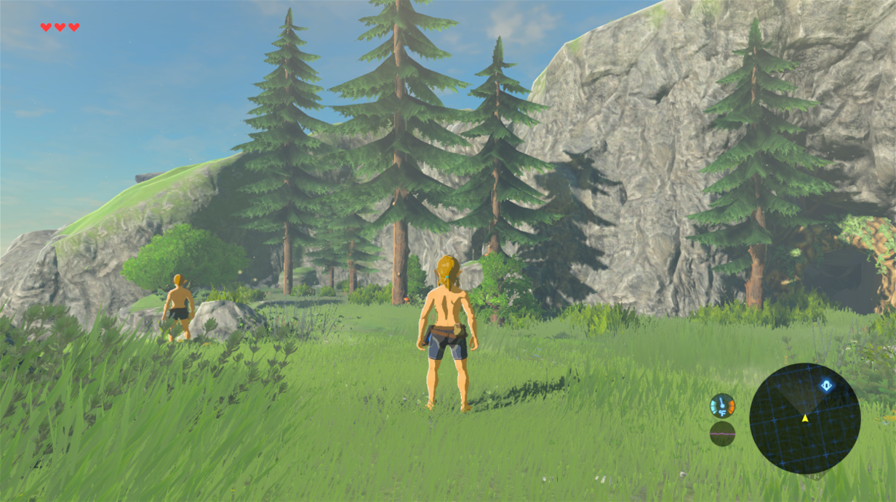
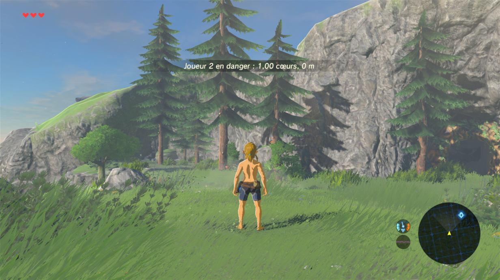
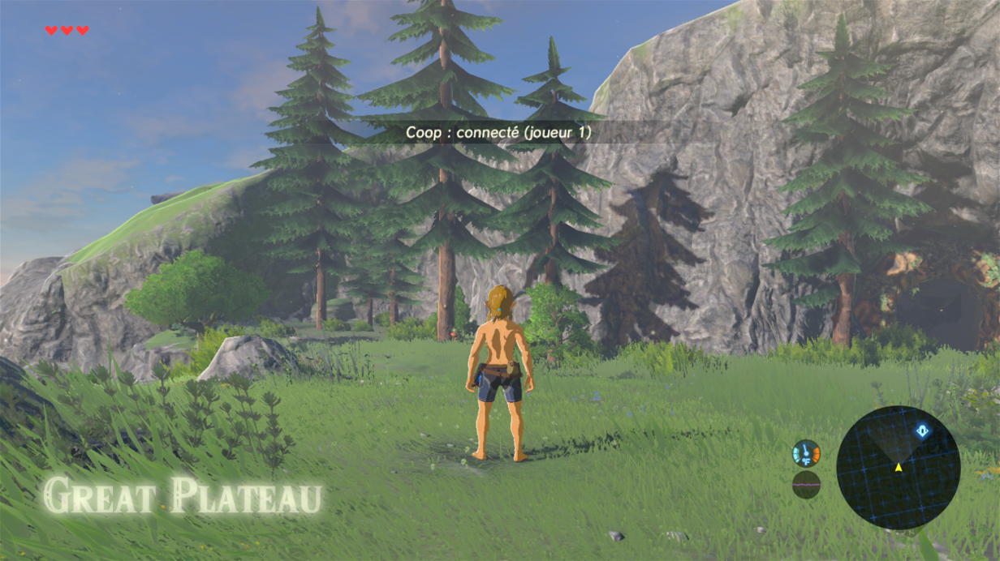
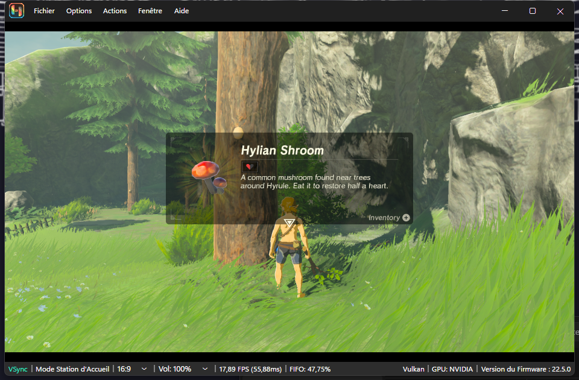
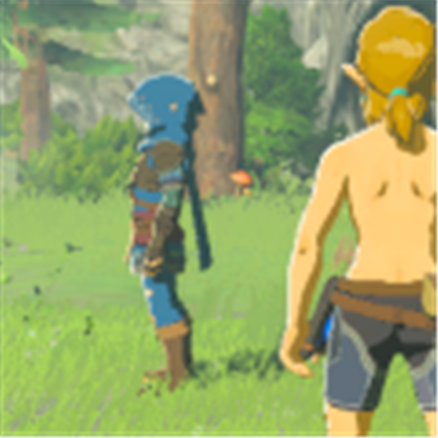
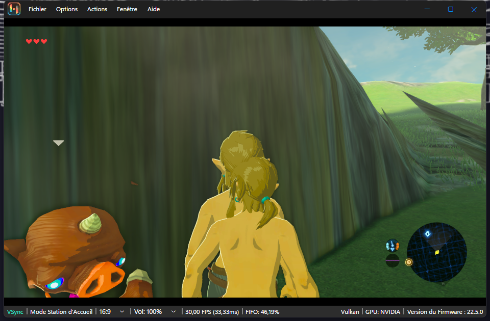

# BOTW coop (prototype)

Mod de présence à deux joueurs pour *The Legend of Zelda: Breath of the Wild* 1.9.0 (Switch), chargé comme plugin (`subsdk9`), sans modifier le jeu. Aucun fichier du jeu n'est dans ce dépôt.



*Le joueur 2 (au centre) voit le joueur 1 (à gauche) dans son monde.*

## Captures

Images prises pendant les essais à deux instances (toutes les preuves : `docs/evidence/`).

| | |
|---|---|
|  |  |
| L'autre joueur est un Link animé : il grimpe, nage, plane comme le vrai | Son armure et ses armes |
|  |  |
| Alerte quand le partenaire n'a presque plus de cœurs | Messages dans le bandeau du jeu |
|  |  |
| Un objet ramassé par l'un disparaît chez l'autre | Les teintures de l'armure sont transmises |
|  |  |
| Un Bokoblin attaque : vu par le joueur 1… | … et par le joueur 2, même place, même animation |

État réel, limites et preuves : `PROGRESS.md`. Détails techniques : `NOTES.md`, `ARCHITECTURE.md`. Décisions : `DECISIONS.md`.

## Ce que fait la version actuelle
- Chaque joueur voit l'autre dans son monde sous la forme d'un Link animé (attente, marche, course, sprint, escalade, nage, vol plané, chute, saut, coups d'épée, tir à l'arc, parade), avec son armure (tête, torse, jambes, teintures comprises) et ses armes, bouclier, arc et carquois.
- Heure de la session (elle ne recule jamais ; un joueur en pause ne retient pas l'autre), jours, minuteur de lune de sang, météo (quand les deux joueurs sont dans le même climat).
- Drapeaux de la liste blanche : progression (sanctuaires, tours, Créatures divines, Koroks) et objets de carte (ramassés, coffres, ennemis tués). Les étapes de quête, l'inventaire et le Compendium restent à chacun.
- Ennemis : points de vie, position et animations (le joueur le plus proche de l'ennemi fait foi, l'autre voit la même chose ; vérifié sur des Bokoblin, combat à l'épée compris : coups, fuite et mort vus par les deux joueurs). `enemy_pos=0` et `enemy_anim=0` dans `romfs\botw-coop.txt` coupent ces partages.
- **Cinématiques partagées** : quand une cinématique démarre chez un joueur, elle démarre aussi chez l'autre s'il est à moins de 50 m ; plus loin, il voit « Joueur N regarde une cinématique ». Vérifié avec la cinématique de la lune de sang, pas encore avec une cinématique de l'histoire. `cutscene=0` coupe, `cutscene_range=<mètres>` change la distance.
- Messages dans le bandeau du jeu quand l'autre joueur arrive ou part, et à la connexion.
- **Téléportation vers l'autre joueur** : maintenir le clic du stick gauche 1,5 s. Jusqu'à 250 m, Link arrive à côté de lui ; plus loin, le jeu fait un voyage (chargement) vers le sanctuaire ou la tour le plus proche de lui, puis Link le rejoint. Un clic court accroupit Link comme d'habitude.
- **Sauvegardes coop séparées** : au premier lancement avec le mod, vos sauvegardes sont copiées dans un dossier `coop` des données de sauvegarde du jeu (les originales sont seulement lues) ; ensuite le jeu ne lit et n'écrit que cette copie. Retirer le mod rend vos sauvegardes normales, inchangées.
- **Sauvetage par le partenaire** : à votre mort, si aucune fée ni la Grâce de Mipha ne vous sauve et que l'autre joueur est en jeu, vivant et à moins de 150 m, vous repartez avec 3 cœurs (au plus une fois toutes les 2 minutes) ; votre partenaire en est averti. Réglages dans `romfs\botw-coop.txt` : `revive=0` pour couper, `revive_delay=<secondes>`, `revive_range=<mètres>`.
- **Dons d'objets** : lâchez (menu « Lâcher ») ou lancez une arme ou un bouclier que vous portiez près de l'autre joueur ; quand il s'arrête à moins de 3 m de lui, il disparaît de votre monde et arrive dans son inventaire, avec son usure et son bonus (« Attaque + »…). Pour un matériau : menu, « Tenir », fermer le menu, puis le poser (A) près de l'autre joueur ; il le reçoit (un exemplaire par objet posé).
- **Repas partagés** : ce que vous mangez depuis le menu soigne aussi l'autre joueur, du même nombre de cœurs (`meal=0` pour couper). Les effets des plats ne sont pas partagés.
- **L'autre joueur sur la carte** : un tampon du jeu marque sa position et le suit ; il disparaît quand il quitte la partie (`map=0` pour couper). Vérifié dans les journaux, pas encore vu sur l'écran de la carte.
- **Contrôle de version** : le relais refuse un jeu dont le mod n'a pas la même version que lui (et inversement) ; un message l'indique dans le jeu, qui réessaie toutes les minutes. Mettre à jour le mod et le relais ensemble.
- Inventaire, santé et équipement restent individuels.

Testé uniquement avec deux instances de Ryujinx 1.3.3 sur un même PC. Non testé entre deux PC, ni sous Eden.

## Installation simple : le launcher

`BotwCoopLauncher.exe` (onglet Releases du dépôt) installe, met à jour et lance le mod. Interface sombre : l'image du jeu affichée en haut est lue dans **votre** `.nsp` (icône du jeu), et les captures du carrousel viennent de ce dépôt ; aucune image du jeu n'est livrée dans l'exe.

1. **Paramètres** (ouverts d'office au premier lancement) : `Ryujinx.exe`, le jeu de base (`.nsp`) et la mise à jour 1.9.0 (`.nsp`). Ryujinx doit déjà avoir vos clés (`prod.keys`).
2. Choisir « J'héberge » (votre adresse s'affiche, à donner à l'autre joueur), « Je rejoins un ami » (avec son adresse) ou **« À deux sur ce PC »**, et un mot de passe si vous voulez. À deux sur ce PC, « Jouer » ouvre deux fenêtres : le joueur 2 a son propre dossier Ryujinx (`%LOCALAPPDATA%\BotwCoop\joueur2`), préparé la première fois à partir du vôtre (clés, réglages, copie de vos sauvegardes si la case est cochée dans les Paramètres). Il faut une manette par joueur : la première fois, réglez celle du joueur 2 dans sa fenêtre (Options > Paramètres > Entrées).
3. **Installer / Mettre à jour** : le launcher télécharge la dernière version du mod, lit dans votre jeu les fichiers dont il a besoin (lecture seule), fabrique le Link de l'autre joueur, la liste des drapeaux partagés, etc. (Python portable de python.org et paquets `oead`, `rstb` de PyPI, dans `%LOCALAPPDATA%\BotwCoop`), puis copie le tout dans le dossier des mods de Ryujinx. Il active « Ignorer les services manquants » et sélectionne la mise à jour 1.9.0 dans Ryujinx (copies de sécurité `*.avant-botw-coop`). Environ une minute la première fois.
4. **Sauvegarde de la partie coop** : le relais de l'hôte garde la progression partagée (sanctuaires, tours, Koroks, objets et coffres pris, ennemis vaincus), l'heure et le jour de la session dans `%LOCALAPPDATA%\BotwCoop\parties\partie-coop.json`, et la redonne à chaque joueur qui entre en jeu. En entrant en jeu, chaque jeu lui renvoie aussi sa propre progression : si c'est l'autre joueur qui héberge la fois suivante, sa partie se reconstruit à partir des deux jeux. Rien n'est jamais retiré. Le pied de page du launcher en donne l'état.
5. **Jouer** : installe le mod s'il ne l'est pas encore, ou la dernière version si elle a changé (les deux joueurs doivent avoir la même, le relais refuse deux versions différentes), puis lance le relais (pour l'hôte, sur le réseau local uniquement) et Ryujinx.

Au démarrage, le launcher se remplace lui-même s'il existe un launcher plus récent : il compare sa version à `launcher.json` de la dernière release, qui ne change que si le launcher a changé (sinon pas de nouveau téléchargement de 52 Mo). Aucun fichier du jeu n'est distribué : tout est fabriqué sur votre PC, à partir de votre copie. Préparer une release : `tools\make-release.ps1 -Version a.b.c` (trois fichiers dans `build\release` : `botw-coop-mod.zip`, `BotwCoopLauncher.exe`, `launcher.json`, à publier comme release `va.b.c` du dépôt public ; la version du launcher est gardée dans `tools\launcher\RELEASED`).

## Jouer à deux (à la main)

Il faut, sur chaque PC : BOTW avec la mise à jour 1.9.0, Ryujinx, et ce dépôt compilé (voir plus bas).

1. **Sur le PC hôte, lancer le relais** :
   ```
   python tools\relay.py --host <adresse LAN du PC hôte> --password <mot de passe>
   ```
   Sans `--host`, le relais n'écoute que sur 127.0.0.1 (deux instances sur le même PC). Windows demandera d'autoriser Python dans le pare-feu : c'est nécessaire pour qu'un autre PC se connecte. Ne pas rediriger de port vers Internet.
   `--password` est conseillé sur un réseau partagé : seuls les jeux qui ont le même mot de passe entrent dans la partie. Il ne passe jamais en clair sur le réseau (défi + SHA-256). Sans `--password`, tout jeu du réseau peut entrer.
2. **Générer les fichiers du mod tirés de votre jeu** (une fois, sur chaque PC ; voir « Liste blanche » plus bas) : liste blanche des drapeaux et Link de l'autre joueur. Sans eux, rien n'est partagé à part la présence, l'heure et les ennemis, et l'autre joueur est un villageois.
3. **Installer le mod dans Ryujinx**, sur chaque PC :
   ```
   powershell -ExecutionPolicy Bypass -File tools\install-mod.ps1 -DataDir "<dossier de données Ryujinx>" -Relay <adresse LAN du PC hôte>:47800 -Password <mot de passe>
   ```
   (`-Password` : le même que celui du relais ; 63 caractères au plus, sans espace ni accent.)
   Le dossier de données est celui qui contient `mods`, `bis`, `system` (installation standard : `%APPDATA%\Ryujinx`). Dans la configuration de Ryujinx, « Ignorer les services manquants » doit être activé (sinon le jeu 1.9.0 s'arrête après environ 2 minutes).
4. Lancer le jeu sur les deux PC et charger une partie. Le personnage de l'autre joueur apparaît une vingtaine de secondes après l'entrée en jeu, s'il est à moins de 120 m.

Désinstaller : `tools\install-mod.ps1 -DataDir "<dossier>" -Uninstall`.

Essai à deux fenêtres sur un seul PC, sans toucher à l'installation réelle de Ryujinx : `tools\play-duo.ps1` (dossiers de données de test dans `build\ryu\`).

## Compiler
Prérequis : MSYS2 avec devkitPro (devkitA64, libnx), exlaunch dans `third_party\exlaunch` (voir NOTES.md pour les versions et les sources).
```
bash plugin/build.sh "<chemin du projet>"
```
Résultat : `build\deploy\subsdk9`.

## Liste blanche des drapeaux

Le mod ne partage que les drapeaux d'une liste générée depuis **votre** copie du jeu (rien de Nintendo n'est dans ce dépôt). Tout reste dans `build\` :

1. SDK .NET portable (script officiel de Microsoft, sans rien installer dans le système) :
   ```
   powershell -ExecutionPolicy Bypass -File build\tools\dotnet-install.ps1 -Channel 10.0 -InstallDir build\tools\dotnet -NoPath
   ```
   (`dotnet-install.ps1` se télécharge depuis `https://dot.net/v1/dotnet-install.ps1`.)
2. Outil de lecture de la RomFS (`tools\romfs-extract`, bibliothèque `Ryujinx.LibHac`) :
   ```
   build\tools\dotnet\dotnet.exe build tools\romfs-extract\RomfsExtract.csproj -c Release -o build\tools\romfs-extract
   build\tools\romfs-extract\RomfsExtract.exe "%APPDATA%\Ryujinx\system\prod.keys" "<jeu de base .nsp>" "<mise à jour 1.9.0 .nsp>" build\romfs-1.9.0 /Pack/Bootup.pack
   ```
   Clés et NSP sont seulement lus.
3. Catalogue des drapeaux puis liste blanche (Python avec le paquet `oead` de PyPI) :
   ```
   python -m venv build\venv
   build\venv\Scripts\python.exe -m pip install oead
   build\venv\Scripts\python.exe -I tools\gamedata_names.py build\romfs-1.9.0 build\gamedata\flags.tsv
   build\venv\Scripts\python.exe -I tools\build_sync_flags.py build\gamedata\flags.tsv build\deploy\romfs\botw-coop\sync-flags.bin
   build\venv\Scripts\python.exe -I tools\build_travel_points.py build\romfs-1.9.0 build\deploy\romfs\botw-coop\travel-points.txt
   ```
   La dernière ligne liste les sanctuaires et tours (voyage vers un partenaire à plus de 250 m).
4. Le Link qui représente l'autre joueur (acteur `CoopPlayer`) et ses pièces d'armure (acteurs `CoopGear_*`), à partir de quelques fichiers de plus :
   ```
   build\tools\romfs-extract\RomfsExtract.exe "%APPDATA%\Ryujinx\system\prod.keys" "<jeu de base .nsp>" "<mise à jour 1.9.0 .nsp>" build\romfs-1.9.0 /Actor/Pack/Npc_DungeonPriest001.sbactorpack /Actor/Pack/PauseMenuPlayer.sbactorpack /Actor/Pack/Armor_ /Actor/Pack/Weapon_ /Model/Armor_ /Actor/ActorInfo.product.sbyml /System/Resource/ResourceSizeTable.product.srsizetable
   build\venv\Scripts\python.exe -m pip install rstb
   build\venv\Scripts\python.exe -I tools\build_puppet.py build\romfs-1.9.0 build\deploy\romfs
   ```
   Sans ces fichiers, l'autre joueur apparaît sous la forme d'un villageois. Sans les `Armor_*` / `Weapon_*`, il apparaît sans armure / sans armes. Sans les modèles `Model/Armor_*`, ses pièces teintes gardent leur couleur d'origine.
5. Noms des objets dans les bandeaux de don (textes français du jeu) :
   ```
   build\tools\romfs-extract\RomfsExtract.exe "%APPDATA%\Ryujinx\system\prod.keys" "<jeu de base .nsp>" "<mise à jour 1.9.0 .nsp>" build\romfs-1.9.0 /Pack/Bootup_EUfr.pack
   build\venv\Scripts\python.exe -I tools\build_item_names.py build\romfs-1.9.0 EUfr build\deploy\romfs
   ```
   Sans ce fichier, le bandeau dit « une arme », « un bouclier », « un arc » ou « un objet ».

`install-mod.ps1` et `run-live.ps1` copient ensuite `build\deploy\romfs` dans le mod.

Groupes (réglage `share_groups=` dans `romfs\botw-coop.txt`, par défaut `1,2`) : 1 progression (1 330 drapeaux), 2 objets de carte (31 539), 3 portes logiques des énigmes (485, inactif par défaut). Tant qu'un joueur n'a pas la paravoile, la progression reçue attend (les sanctuaires du plateau donnent les runes).

## Outils de test
`tools\run-live.ps1` et `tools\drive.py` lancent une ou deux instances et les pilotent par le réseau (déplacements, boutons, captures d'écran). Ils demandent une build de test (`-Defines '-DCOOP_REMOTE_PAD'`), à ne pas utiliser pour jouer. Options d'essai de l'armure : `-DCOOP_TEST_SPAWN -DCOOP_TEST_GEAR` (Link témoin à 3 m, en tenue hylienne), `-DCOOP_TEST_WEAR` (deux instances : J1 annonce la tenue 001, J2 la tenue 005), `-DCOOP_TEST_GIVE` (ajoute pommes, armure hylienne, épée, bouclier et arc à l'inventaire de la copie de test, à équiper par le menu ; avec `-DCOOP_TEST_BONUS`, l'épée a le bonus « Attaque + » 10). `drive.py <nom> lift` soulève Link de 50 m (essai du sauvetage). Réseau dégradé : `relay.py --lag 150 --jitter 50` retarde chaque message de 150 à 200 ms (`run-live.ps1 -RelayArgs '--lag 150 --jitter 50'`) ; `--pretend-version 99` fait passer le relais pour une autre version.
